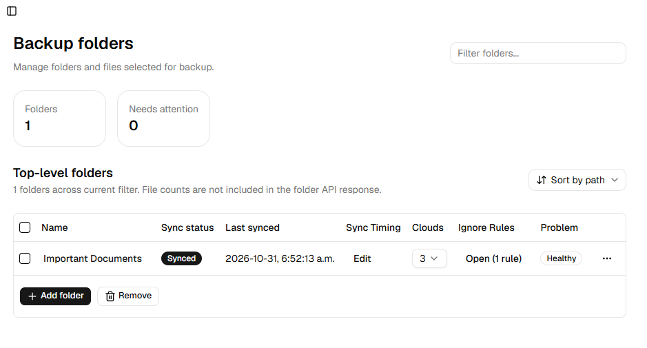
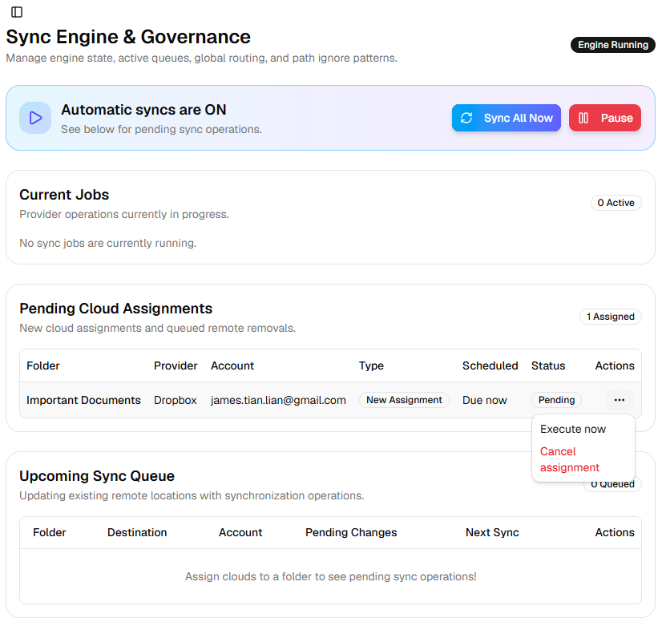
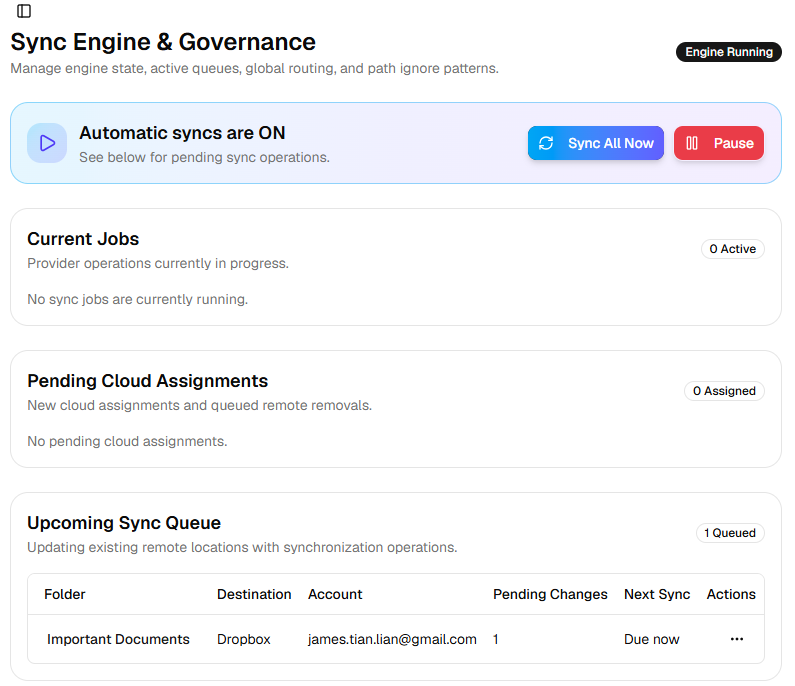
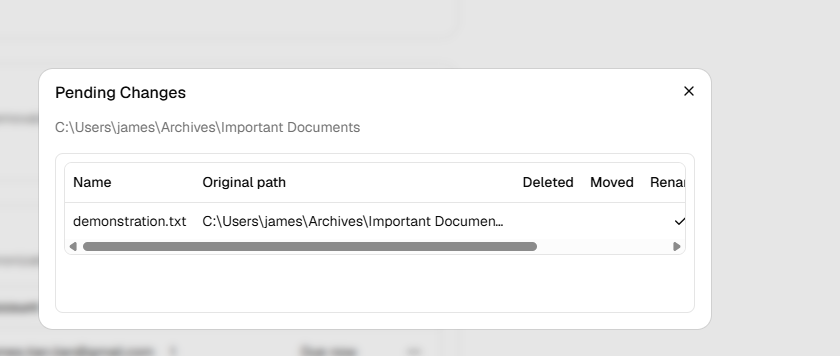

# How to Use
Version 0.0.1 (2026-10-31)

### Step 1
Open the `Link services` page, choose a provider (Google Drive, Microsoft, or OneDrive), and press `Add account`.   You may link any number of Google Drive, Microsoft, or OneDrive accounts that you'd like.

### Step 2
Open the `Folders & files` page, and select `Add folder`. Choose a folder that you'd like to be monitored and synced to a cloud. 

In the `Folders & files` page, you can configure a number of different settings related to the watched folder. 
- Click on the folder name to view its contents
- Ctrl-click on the folder name to open it in the File Exporer
- View the last-synced date
- Adjust the sync timing (WARNING! Untested feature. Recommended to set automatic syncs to inactive for now.)
- Select the `Clouds` you'd like the folder to be synced to from the dropdown
    - Note: you can only select clouds when you have linked an account in `Link services`
- Configure the `Ignore Rules` globs
    - much like `.gitignore`, you can configure ignore rules for files you want ignored during syncing
    - see the [VS Code glob patterns reference](https://code.visualstudio.com/docs/editor/glob-patterns) for more details
    - ignored paths will show up as gray when clicking the folder name to view its contents
 

## Step 3
Once you have assigned clouds to your watched folder, a new row will appear in the `Pending Cloud Assignments` table on the `Sync status` page.

Press `Execute now` to perform the bootstrap cloud assignment. 

Congratulations! Now, any changes that are made to your watched folder are now tracked and will be scheduled and reproduced in your remote cloud folder.

Press on the folder name in the `Upcoming Sync Queue` to view the aforementioned tracked changes.
