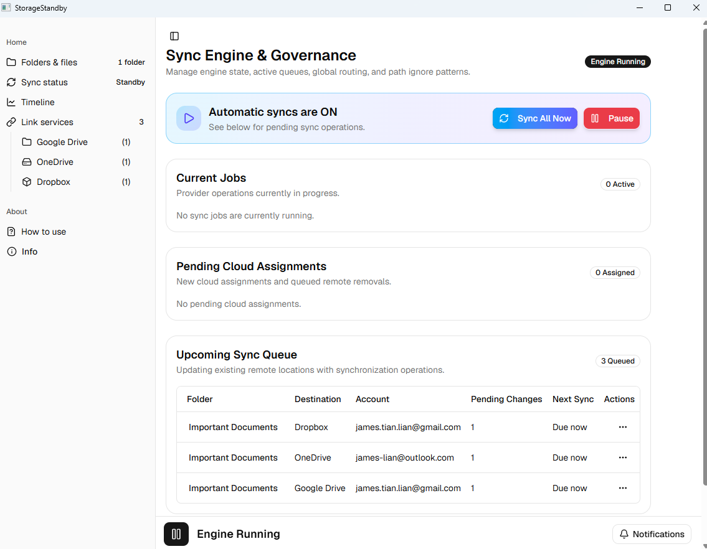
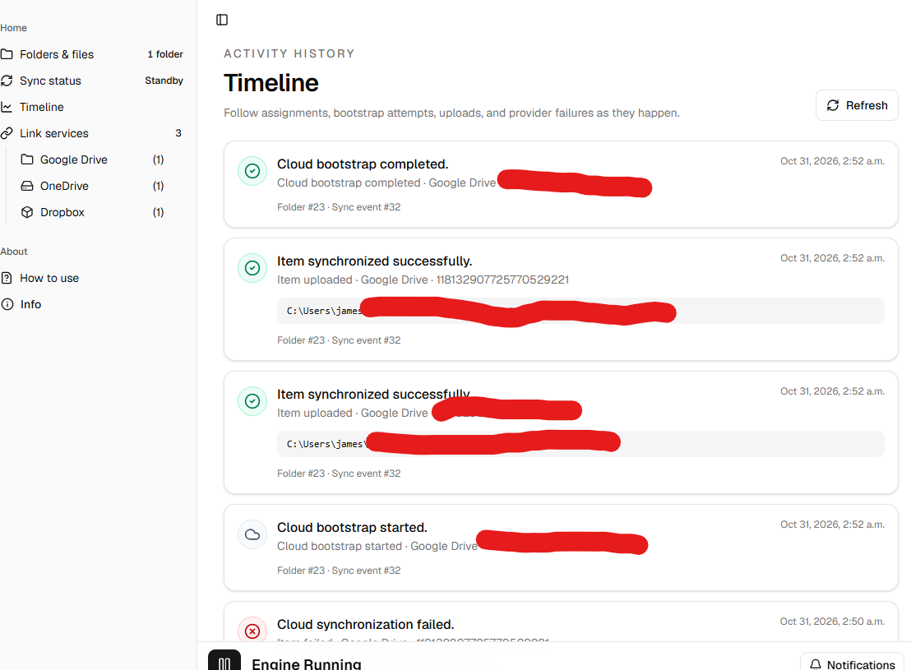
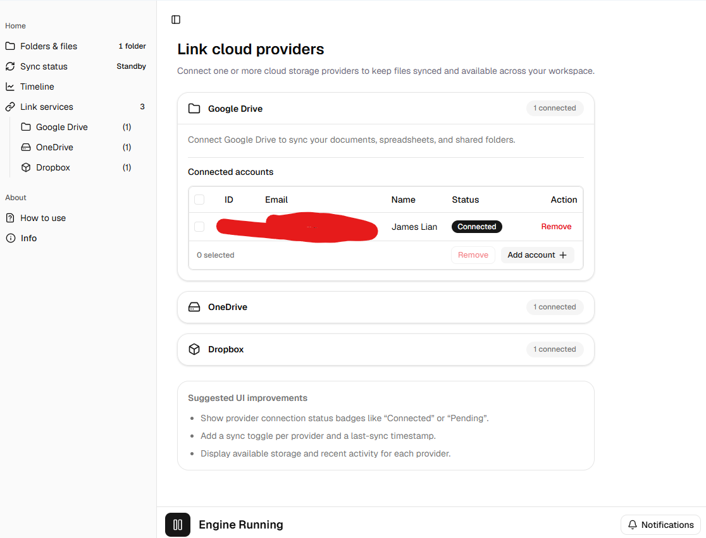

# StorageStandby: A hybrid fullstack Windows application that automatically backs up your files

Stardance tracker project: https://stardance.hackclub.com/projects/27442 (began development June 2026)

StorageStandby is a hybrid native fullstack developed for Windows that automatically backs up selected folders and files to a variety of online-based drives. The app provides a unified dashboard for the following supported providers:
- Google Drive
- Microsoft OneDrive
- Dropbox

Traditional cloud backup apps can consume a large amount of RAM and CP cycles, and some offer a rigid user experience with aggressive hijacking, and conflicting files and sync loops.  
StorageStandby allows users to dictate exactly WHAT files are touched, and WHERE the files are synced to. 

## 🚧 Project Status: WIP
| Date | Status | Notes |
|---------|----------|-------------|
| October 31, 2026 | v0.0.1 released | Several key features are still unfinished, such as automatic backups. Core features such as remote syncs and folder-change tracking work. |

## 💡 Features
- automatic sync timings (WIP - untested)
-manage multiple different accounts for multiple providers (e.g. you can sync backups to three Google Drive accounts, two OneDrive accounts, and four Dropbox accounts)
- ignore rules for synced folders (see [VS Code glob patterns reference](https://code.visualstudio.com/docs/editor/glob-patterns))
- upload a remote version of a local folder to multiple different clouds
- track changes made to a watched folder
- reproduce those changes in a cloud backup
- system tray icon for easy access
- notification center

For a more clear explanation of the features, see [HOWTOUSE.md](https://github.com/James-Lian/StorageStandby/blob/main/HOWTOUSE.md).

## ⚙️ Technologies Used
- Vite React Typescript frontend w/ shadcn-ui package
- WPF middleware shell
- ASP.NET C# Core backend running as a Windows Service

## 📃 How to Use
See [HOWTOUSE.md](https://github.com/James-Lian/StorageStandby/blob/main/HOWTOUSE.md)

## 🖼️ Images

